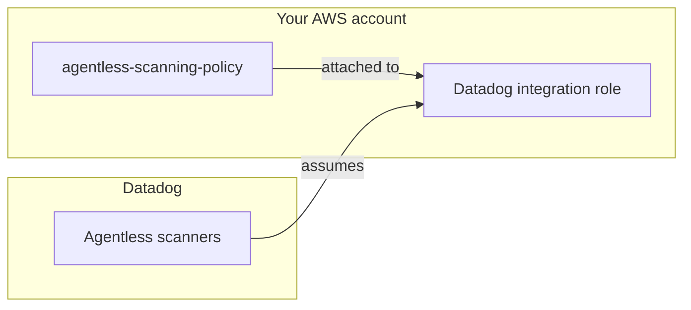
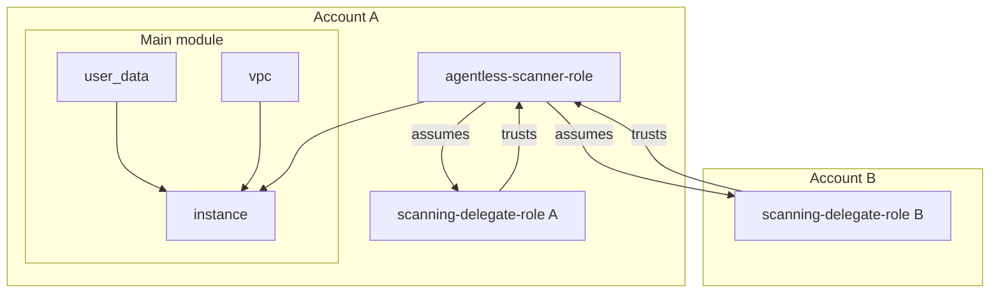

# Terraform Module Datadog Agentless Scanner

Terraform modules to set up [Datadog Agentless Scanning](https://docs.datadoghq.com/security/cloud_security_management/agentless_scanning/) on AWS, Azure and GCP.

This README covers AWS. For Azure and GCP, jump to [Azure and GCP](#azure-and-gcp).

**Jump to:** [Choose a mode](#choose-a-deployment-mode-aws) · [Datadog-hosted (SaaS) quick start](#datadog-hosted-saas-mode-quick-start) · [Self-hosted quick start](#self-hosted-mode-quick-start) · [All examples](#aws-examples) · [Architecture](#aws-architecture)

## Choose a deployment mode (AWS)

Agentless Scanning on AWS runs in one of two modes. You choose per AWS account. Datadog recommends Datadog-hosted (SaaS) mode unless you need scanned data to stay in your account.

| | **Datadog-hosted (SaaS) mode** | **Self-hosted mode** |
|---|---|---|
| Where scanners run | Datadog's infrastructure | EC2 instances in your AWS account |
| What Terraform creates in your account | One IAM managed policy, attached to your existing Datadog integration role | VPC, NAT gateway, Auto Scaling group, scanner IAM role, a delegate role per scanned account |
| Credentials | Datadog API key + application key (to configure scan options) | Datadog API key **with Remote Configuration enabled**, plus an application key |
| Scanner infrastructure cost in your account | None | ~$60/month per region with a scanner, plus data transfer |
| Clouds | AWS only | AWS, Azure, GCP |
| **Start here** | [**Datadog-hosted (SaaS) example**](./examples/saas/) | [**Single region example**](./examples/single_region/) |

In Datadog-hosted mode, Datadog reads snapshot blocks, Lambda code and S3 objects from your account into its own infrastructure to scan them. In self-hosted mode, that data stays in your account and only scan results are sent to Datadog.

## Datadog-hosted (SaaS) mode quick start

Nothing runs in your account. You attach the scanning permissions to the Datadog integration role, and Datadog assumes that role to scan.

**Before you start:** your AWS account must already be [integrated with Datadog](https://docs.datadoghq.com/integrations/amazon_web_services/), and you need the name of that integration's IAM role (often `DatadogIntegrationRole`).

```hcl
module "agentless_scanning_policy" {
  source = "git::https://github.com/DataDog/terraform-module-datadog-agentless-scanner//modules/agentless-scanning-policy?ref=0.13.0"
}

resource "aws_iam_policy" "agentless_scanning" {
  name_prefix = "DatadogAgentlessScanningPolicy"
  policy      = module.agentless_scanning_policy.json
}

resource "aws_iam_role_policy_attachment" "agentless_scanning" {
  role       = "DatadogIntegrationRole" # your Datadog integration role name
  policy_arn = aws_iam_policy.agentless_scanning.arn
}
```

Then turn on the scan types you want with the `datadog_agentless_scanning_aws_scan_options` resource. The [**Datadog-hosted (SaaS) example**](./examples/saas/) has the complete, runnable configuration, including the Datadog provider and scan options.

## Self-hosted mode quick start

Scanners run on EC2 in your account. You need a Datadog [API key](https://docs.datadoghq.com/account_management/api-app-keys/) with **Remote Configuration enabled**. This is the most common self-hosted setup issue.

Start with the [**Single region example**](./examples/single_region/), then see [AWS examples](#aws-examples) for multi-region, cross-account and custom VPC setups.

## AWS examples

| Example | Mode | Use it when |
|---|---|---|
| [Datadog-hosted (SaaS)](./examples/saas/) | Datadog-hosted | You don't want any scanner infrastructure in your account |
| [Single region](./examples/single_region/) | Self-hosted | Getting started, or most of your hosts are in one region |
| [Multi region](./examples/multi_region/) | Self-hosted | You have significant workloads in several regions and want to avoid cross-region transfer costs |
| [Cross account](./examples/cross_account/) | Self-hosted | You want one scanner account to scan many AWS accounts |
| [Custom VPC](./examples/custom_vpc/) | Self-hosted | You want to reuse an existing VPC instead of creating one |
| [Custom Agent configuration](./examples/custom_agent_configurations/) | Self-hosted | You need to pass custom config to the Datadog Agent running next to the scanners |

More detail on each in [examples/README.md](./examples/).

## Versioning

> [!IMPORTANT]
> [Pin](https://developer.hashicorp.com/terraform/language/modules/sources#selecting-a-revision) the module version with `?ref=<version>` in every `source`, for both modes. Unpinned sources track `main` and can change under you. The latest version is in the [changelog](CHANGELOG.md).

## AWS architecture

### Datadog-hosted (SaaS) mode

Scanners run in Datadog's infrastructure: no scanner is deployed in your account. The [agentless-scanning-policy](./modules/agentless-scanning-policy/) module provides the scanning permissions as a single policy document. You create it as a managed policy and attach it to the Datadog integration role. Datadog assumes this role to perform the scans.

Full setup: [**Datadog-hosted (SaaS) example**](./examples/saas/).



### Self-hosted mode

Scanners run in your own AWS infrastructure. They require a Datadog [API key](https://docs.datadoghq.com/account_management/api-app-keys/) with Remote Configuration enabled. The following modules are used:

- [Main module](./main.tf): a thin wrapper around the [vpc](./modules/vpc/), [user_data](./modules/user_data/) and [instance](./modules/instance/) modules, which create the network, the scanner install script and the Auto Scaling group running the scanners.
- [agentless-scanner-role](./modules/agentless-scanner-role/): IAM role and instance profile for the scanner instances, allowing them to assume the scanning delegate roles.
- [scanning-delegate-role](./modules/scanning-delegate-role/): IAM role created in each scanned account, holding the permissions to scan its resources (EBS snapshots, Lambdas, etc.).
- [agentless-scanners-autoscaling](./modules/agentless-scanners-autoscaling/): attaches the policy allowing Datadog to scale the scanners up or down based on load.

Full setup: [**Single region example**](./examples/single_region/).



## Azure and GCP

Datadog-hosted mode is AWS only. Azure and GCP use self-hosted scanners.

- **Azure**: [Azure module](./azure/README.md#usage), or the [ARM template](./azure/arm/).
- **GCP**: [GCP module](./gcp/README.md) and [GCP examples](./gcp/examples/).

## Development

Install pre-commit checks:

```
pre-commit install
```

Automatically generate documentation for the Terraform modules:

```
pre-commit run terraform-docs-go -a
```

Lint Terraform code:

```
pre-commit run terraform_fmt -a
pre-commit run terraform_tflint -a
```

Run all checks:

```
pre-commit run -a
```

## Changelog

See [changelog](CHANGELOG.md).

## Root module reference (self-hosted)

The inputs and outputs below are for the root module, which deploys self-hosted scanners. Datadog-hosted mode doesn't use the root module: see [agentless-scanning-policy](./modules/agentless-scanning-policy/) instead.

<!-- BEGIN_TF_DOCS -->
## Requirements

| Name | Version |
|------|---------|
| <a name="requirement_terraform"></a> [terraform](#requirement\_terraform) | >= 1.2.0 |
| <a name="requirement_aws"></a> [aws](#requirement\_aws) | >= 5.0 |

## Providers

No providers.

## Modules

| Name | Source | Version |
|------|--------|---------|
| <a name="module_instance"></a> [instance](#module\_instance) | ./modules/instance | n/a |
| <a name="module_user_data"></a> [user\_data](#module\_user\_data) | ./modules/user_data | n/a |
| <a name="module_vpc"></a> [vpc](#module\_vpc) | ./modules/vpc | n/a |

## Resources

No resources.

## Inputs

| Name | Description | Type | Default | Required |
|------|-------------|------|---------|:--------:|
| <a name="input_agent_configuration"></a> [agent\_configuration](#input\_agent\_configuration) | Specifies a custom configuration for the Datadog Agent. The specified object is passed directly as a configuration input for the Datadog Agent. For more details: https://docs.datadoghq.com/agent/configuration/agent-configuration-files/. Warning: this is an advanced feature and can break the Datadog Agent if not used correctly. | `any` | `{}` | no |
| <a name="input_api_key"></a> [api\_key](#input\_api\_key) | Specifies the API key required by the Agentless Scanner to submit vulnerabilities to Datadog - Make sure the API key is Remote Configuration enabled. | `string` | `null` | no |
| <a name="input_api_key_secret_arn"></a> [api\_key\_secret\_arn](#input\_api\_key\_secret\_arn) | ARN of the secret holding the Datadog API key. Takes precedence over api\_key variable - Make sure the API key is Remote Configuration enabled. | `string` | `null` | no |
| <a name="input_enable_ssm"></a> [enable\_ssm](#input\_enable\_ssm) | Whether to enable AWS SSM to facilitate executing troubleshooting commands on the instance | `bool` | `false` | no |
| <a name="input_enable_ssm_vpc_endpoint"></a> [enable\_ssm\_vpc\_endpoint](#input\_enable\_ssm\_vpc\_endpoint) | Whether to enable AWS SSM VPC endpoint (only applicable if enable\_ssm is true) | `bool` | `true` | no |
| <a name="input_instance_count"></a> [instance\_count](#input\_instance\_count) | Default size of the autoscaling group the instance is in (i.e. number of instances with scanners to run) | `number` | `1` | no |
| <a name="input_instance_profile_name"></a> [instance\_profile\_name](#input\_instance\_profile\_name) | Name of the instance profile to attach to the instance | `string` | n/a | yes |
| <a name="input_instance_type"></a> [instance\_type](#input\_instance\_type) | The type of instance running the scanner | `string` | `"t4g.medium"` | no |
| <a name="input_scanner_channel"></a> [scanner\_channel](#input\_scanner\_channel) | Channel of the scanner to install from (stable or beta). | `string` | `"stable"` | no |
| <a name="input_scanner_configuration"></a> [scanner\_configuration](#input\_scanner\_configuration) | Specifies a custom configuration for the scanner. The specified object is passed directly as a configuration input for the scanner. Warning: this is an advanced feature and can break the scanner if not used correctly. | `any` | `{}` | no |
| <a name="input_scanner_repository"></a> [scanner\_repository](#input\_scanner\_repository) | Repository URL to install the scanner from. | `string` | `"https://apt.datadoghq.com/"` | no |
| <a name="input_scanner_version"></a> [scanner\_version](#input\_scanner\_version) | Version of the scanner to install | `string` | `"0.11"` | no |
| <a name="input_site"></a> [site](#input\_site) | By default the Agent sends its data to Datadog US site. If your organization is on another site, you must update it. See https://docs.datadoghq.com/getting_started/site/ | `string` | `null` | no |
| <a name="input_tags"></a> [tags](#input\_tags) | A map of additional tags to add to the IAM role/profile created | `map(string)` | `{}` | no |

## Outputs

| Name | Description |
|------|-------------|
| <a name="output_api_key_secret_arn"></a> [api\_key\_secret\_arn](#output\_api\_key\_secret\_arn) | The ARN of the secret containing the Datadog API key |
| <a name="output_vpc"></a> [vpc](#output\_vpc) | The VPC created for the Datadog agentless scanner |
<!-- END_TF_DOCS -->
